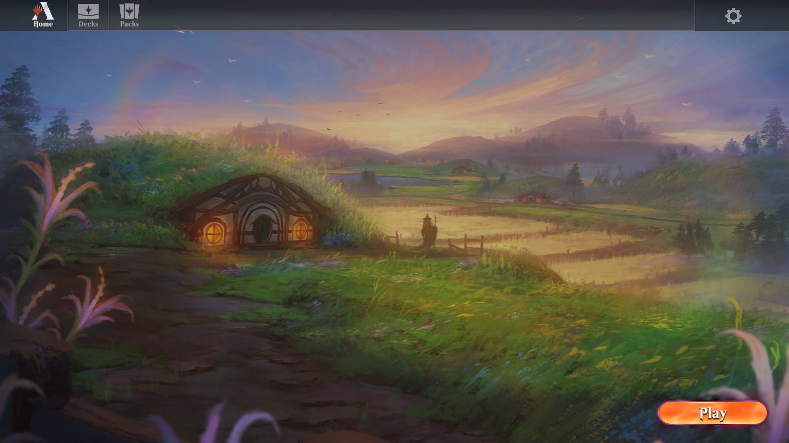

# Forge Arena Sandbox

A local Magic sandbox using your installed Arena's original screens, cards and
animations. Forge runs the bot and supported rules.

**[Download the gameplay alpha for Windows](https://github.com/kgeg401/forge-arena-sandbox/releases/tag/v0.2.0-alpha.15.mp.8)**

Download **ForgeArenaSandbox-Windows.zip** from that release. GitHub's **Code >
Download ZIP** contains source code, not the installable client.

*Actual sandbox capture. Original Arena presentation is loaded from the user's
separate installation; game assets are not bundled with the client.*

## Install

1. Install MTG Arena separately and finish downloading its game content.
2. Extract the entire sandbox release ZIP and run **Setup.exe**.
3. Choose your Arena folder and a separate sandbox folder. **Check Arena**
   verifies compatibility; **Install sandbox** checks and installs everything.
4. Open **Forge Arena Sandbox** in the installed folder. Its dedicated launcher
   is **ForgeArenaSandbox.exe**.

Setup handles Forge, private Java/.NET runtimes and the loader. It installs the
pinned official Python build if needed. Tested Arena builds are
**Client0.1.14589.1332174** and **Client0.1.14517.1329972**, each with its matching
database and Unity 6000.3.14f1. [Compatibility and tested boundaries](docs/ARENA-COMPATIBILITY.md).
Allow space for an independent Arena copy; setup checks the required space.

## Play

**Horde and ten-player Commander are included.** See [all game modes and exact menu locations](docs/GAME-MODES.md).

**Shared starter content:** every profile receives the project's 26 saved decks
and 521 collection entries (928 copies). Existing decks and collection progress
are retained. [How starter content is added](docs/STARTER-CONTENT.md).

**Play with a friend:** choose **Brawl > Private Commander (Internet)** with a saved deck, then Host or Join. Two humans, 40 life, private invitation; both need the same build. [Full setup and limits](docs/MULTIPLAYER.md).

- **Home > Play > Play:** choose Practice Bot and a valid deck. **White Lifegain**
  is a straightforward first match.
- **Home > Play > Brawl:** choose Brawl Bot and **Jace Superfriends Brawl**, **Emry Brawl**, or **Isamaru Brawl**.
  These use 99 cards plus a commander, 25 life and a free first mulligan.
- **Commander:** in the Brawl tab choose **Commander Bot (40 Life)** for one opponent, or **Commander Pod (4 Players)** for you and three easy Forge bots. These use 40 life, commander tax and 21 commander combat damage. The four-player table and public-zone controls are experimental. Choose **Commander Pod (10 Players - Experimental)** for one human and nine bots: attacks go left until four players remain, then may target anyone. The larger table uses a player rail and selectable watched boards.
- **Zombie Horde:** choose **Zombie Horde (Commander Deck)** under Brawl to use a saved commander deck, or **Zombie Horde (Solo)** under Play for a practice deck. You start at 40 life against a 200-card Zombie/Horror Horde containing 52 revival cards. Commander prep turns equal the commander’s mana value (minimum one); practice decks get three. See [Horde rules and limits](docs/ZOMBIE-HORDE.md).
- **Paper Darien:** select **FREAK-OFF Darien (Paper Commander)** in Commander Horde for the original 100-card paper list and six prep turns. Its 31 paper-only cards have working local presentation/rules mappings and load locally cached illustrations through the original renderer. See [deck details and limits](docs/PAPER-DARIEN.md).
- **New practice decks:** visit Decks for **Fire and Growth** and **Trample and Growth**.
- **Decks:** create, import Arena deck text, edit, duplicate, export and delete
  local decks. The Brawl editor has the original commander slot.
- **Packs:** use the original pack carousel, reveal animations and Continue
  controls. Fresh profiles receive 100 sandbox packs for each supported set.
- Finish or concede a game, then Continue to Home. Start another match without
  restarting the client.

The original deck search, color/land controls, advanced type/rarity/mana filters,
card zoom and size controls are connected to local data. Graphics and audio use
the native Options screens. Home, decks, packs and preferences persist locally.
Upgraded installations retain their existing deck names and libraries.

## Latest interaction and efficiency update

- Reuses visible-card projections during token changes to reduce repeated work. Real interaction checks cover token creation/combat, copies, hidden choices, phasing and Class level/reset behavior.
- Null release checksums retain the verified installed client instead of stopping startup.
- Recoverable display errors show the original Continue dialog; fatal errors offer Return Home without replacing another open dialog.
- Small UI notices no longer reparse the entire board every second.
- Future marked closed-match diagnostics are limited to three folders and 512 MiB. Older unmarked archives and saved decks are preserved; export and full-history options are in [Help](docs/FAQ.md).
- Includes the previous rail updates: Arena-styled pod controls, elimination/spectator flow, paged commander damage, exile ordering, concurrent coin flips, combat protection and reduced rules-response memory retention.

## Alpha limits

**370 main-deck card names remain in the verified baseline.** Another **1,421 names** are enabled experimentally (1,791 primary names total). These include the Arena-compatible Moxfield pool, Zombie/Horror cards, paper Darien, Gamba Gamba and the newer creature-combo/copy decks. Experimental admission is not proof of every effect or interaction. See [coverage](docs/MOXFIELD-COVERAGE.md), [supported cards](docs/SUPPORTED-CARDS.md) and [verification](docs/VERIFICATION.md).

Mandatory triggers now use the original **Auto Order Triggers** preference and advance without an ordering prompt by default. **Auto Choose Replacement Effects** also works, using Forge's automatic chooser while retaining the manual override. Genuine target selections, optional effects and response windows remain. This release also connects the original spell-damage allocation controls and adds shared support for several targeting, channel, cycling, ninjutsu, Class and Battle scenarios.

Private Commander connects two humans over the internet. Horde is solo against a scripted format using Forge's rules and AI choices; Commander pods mean one human and three or nine bots on this PC. Human multiplayer pods, online matchmaking, retail account services, full card coverage and complete retail UI parity are unfinished. Packs use custom sandbox collation, without retail wildcard rewards, bonus sheets or duplicate protection. Opening a card does not enable its rules.

Return Home or closing the client ends that match; player-facing durable match save/restore is not implemented. Decks, packs and preferences persist separately.

[See the Brawl panel and a native Emry match](docs/SCREENS.md).

This is an unofficial experiment. Arena is required separately; its assets are
not distributed here. The game runs with zero Windows network capabilities.
The external installer/updater downloads prerequisites and adapter releases. A separate worker connects private rooms through a temporary authenticated HTTPS tunnel; the host must stay open. [Connection and trust](docs/MULTIPLAYER.md).

## Update

Close the game and reopen **ForgeArenaSandbox.exe**. It checks GitHub and applies
a newer release automatically. Running Setup.exe again is normally unnecessary.
Saved decks, packs and settings stay outside the version folders and are backed
up before updates. Failed/offline checks retain the verified installed version.

An older test.3/test.6 launcher may show its old hub once after updating. Choose
**Start practice** once; subsequent launches use the new dedicated launcher.

## Help and source

- [Installation, updates and troubleshooting](docs/FAQ.md)
- [What has actually been tested](docs/VERIFICATION.md)
- [Report a reproducible problem](https://github.com/kgeg401/forge-arena-sandbox/issues/new/choose)
- [Developer notes and source layout](docs/DEVELOPMENT.md)
- [Catalogue batch checks and development tools](development/README.md)

Dependencies retain their licenses. Credits include Card-Forge/Forge, BepInEx,
Eclipse Adoptium, Microsoft .NET, Python and Google Gson. Development is AI
assisted with OpenAI Codex. See [testing permission and attribution](LICENSE.txt).
