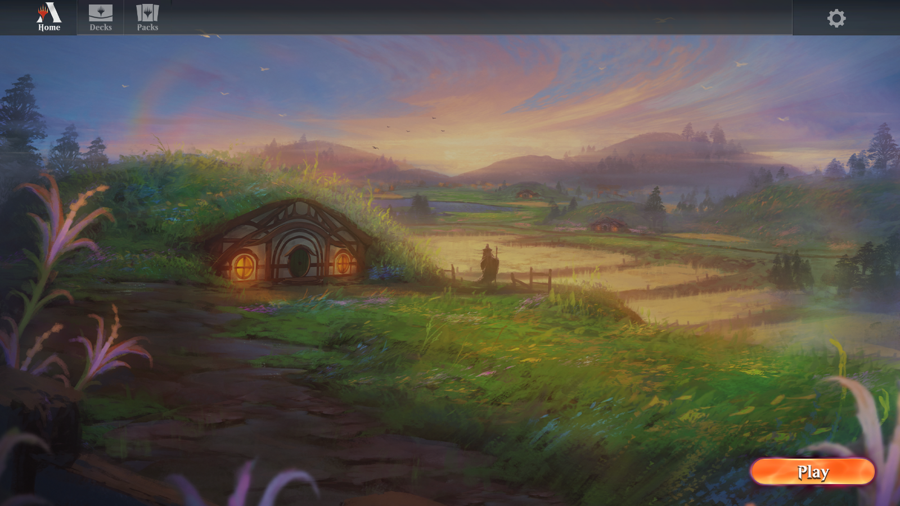

# Forge Arena Sandbox

A local Magic sandbox using your installed Arena's original screens, cards and
animations. Forge runs the bot and supported rules.

**[Download the gameplay alpha for Windows](https://github.com/kgeg401/forge-arena-sandbox/releases/tag/v0.2.0-alpha.9)**

Download **ForgeArenaSandbox-Windows.zip** from that release. GitHub's **Code >
Download ZIP** contains source code, not the installable client.

*Actual sandbox capture. Original Arena presentation is loaded from the user's
separate installation; game assets are not bundled with the client.*

## Install

1. Install MTG Arena separately and finish downloading its game content.
2. Extract the entire sandbox release ZIP and run **Setup.exe**.
3. Choose your Arena folder and a separate sandbox folder. **Check Arena**
   verifies compatibility; **Install sandbox** checks and installs everything.
4. Open **Forge Arena Sandbox** in the installed folder. Its dedicated launcher
   is **ForgeArenaSandbox.exe**.

Setup handles Forge, private Java/.NET runtimes and the loader. It installs the
pinned official Python build if needed. Only the tested Arena build is accepted:
**Client0.1.14517.1329972 / Unity 6000.3.14f1**, with its matching card database.
Allow space for an independent Arena copy; setup checks the required space.

## Play

- **Home > Play > Play:** choose Practice Bot and a valid deck. **White Lifegain**
  is a straightforward first match.
- **Home > Play > Brawl:** choose Brawl Bot and **Jace Superfriends Brawl**, **Emry Brawl**, or **Isamaru Brawl**.
  These use 99 cards plus a commander, 25 life and a free first mulligan.
- **Commander:** in the Brawl tab choose **Commander Bot (40 Life)** for one opponent, or **Commander Pod (4 Players)** for you and three easy Forge bots. These use 40 life, commander tax and 21 commander combat damage. The four-player table and public-zone controls are experimental.
- **New practice decks:** visit Decks for **Fire and Growth** and **Trample and Growth**.
- **Decks:** create, import Arena deck text, edit, duplicate, export and delete
  local decks. The Brawl editor has the original commander slot.
- **Packs:** use the original pack carousel, reveal animations and Continue
  controls. Fresh profiles receive 100 sandbox packs for each supported set.
- Finish or concede a game, then Continue to Home. Start another match without
  restarting the client.

The original deck search, color/land controls, advanced type/rarity/mana filters,
card zoom and size controls are connected to local data. Graphics and audio use
the native Options screens. Home, decks, packs and preferences persist locally.
Upgraded installations retain their existing deck names and libraries.

## Alpha limits

**370 main-deck card names remain in the verified baseline.** Another **343 names** are enabled experimentally, including the Jace Superfriends starter. Admission and per-card smoke checks are not proof of every effect or interaction. Runtime gaps remain explicit; see [supported cards](docs/SUPPORTED-CARDS.md) and [verification](docs/VERIFICATION.md).

All four queues create local games against Forge bots. Four-player Commander means one human and three bots on this PC. Network multiplayer, online matchmaking, retail account services, full card coverage and complete retail UI parity are unfinished. Packs use custom sandbox collation, without retail wildcard rewards, bonus sheets or duplicate protection. Opening a card does not enable its rules.

Home can park and resume the same running practice match. Closing the client ends that match; durable match saves are not implemented. Decks, packs and preferences persist separately.

[See the Brawl panel and a native Emry match](docs/SCREENS.md).

This is an unofficial experiment. Arena is required separately; its assets are
not distributed here. The game runs with zero Windows network capabilities.
The external installer/updater downloads prerequisites and adapter releases.

## Update

Close the game and reopen **ForgeArenaSandbox.exe**. It checks GitHub and applies
a newer release automatically. Running Setup.exe again is normally unnecessary.
Saved decks, packs and settings stay outside the version folders and are backed
up before updates. Failed/offline checks retain the verified installed version.

An older test.3/test.6 launcher may show its old hub once after updating. Choose
**Start practice** once; subsequent launches use the new dedicated launcher.

## Help and source

- [Installation, updates and troubleshooting](docs/FAQ.md)
- [What has actually been tested](docs/VERIFICATION.md)
- [Report a reproducible problem](https://github.com/kgeg401/forge-arena-sandbox/issues/new/choose)
- [Developer notes and source layout](docs/DEVELOPMENT.md)
- [Catalogue batch checks and development tools](development/README.md)

Dependencies retain their licenses. Credits include Card-Forge/Forge, BepInEx,
Eclipse Adoptium, Microsoft .NET, Python and Google Gson. Development is AI
assisted with OpenAI Codex. See [testing permission and attribution](LICENSE.txt).
