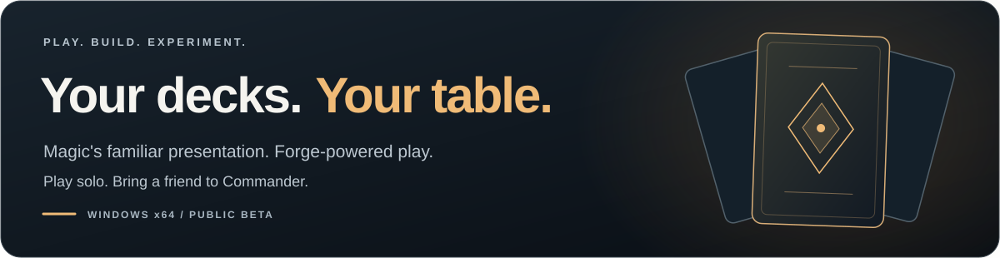
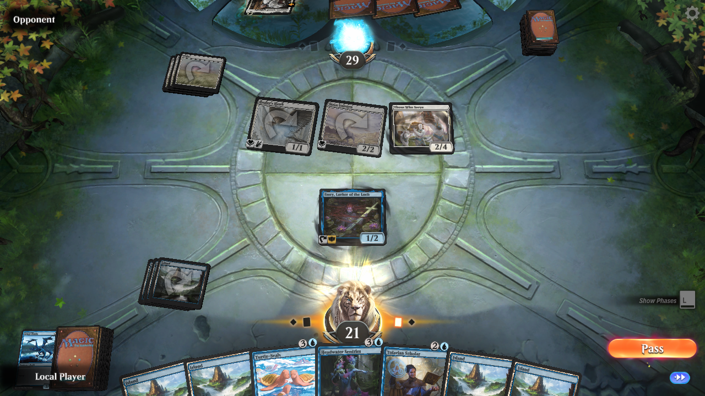
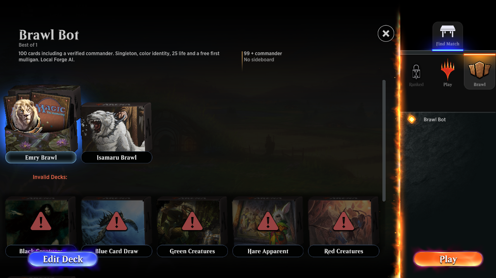
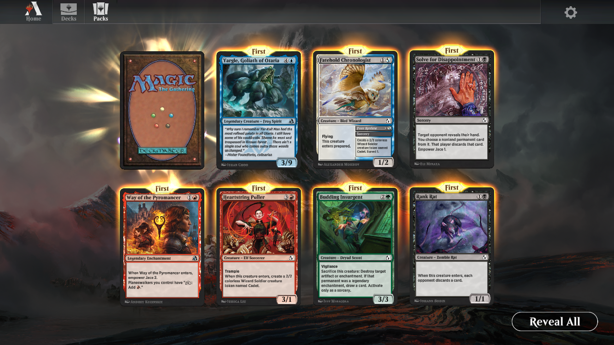

<h1 align="center">Forge Arena Sandbox</h1>

  

  A personal Magic sandbox with <strong>Arena's original presentation</strong> and <strong>Forge's rules engine</strong>. 
  Solo matches, private Commander, and a few unusual ways to play.

  

  <a href="#quick-start">Quick start</a> · <a href="#play-with-a-friend">Play with a friend</a> · <a href="docs/SCREENS.md">Screenshots</a> · <a href="docs/FAQ.md">Help</a>

Windows x64 · Experimental alpha · MTG Arena installed separately

Actual sandbox gameplay. Arena artwork and presentation load from your own installation.

## Pick your next game

| Mode | Your table |
| :--- | :--- |
| **Practice & Brawl** | Test a deck against a Forge bot. Brawl uses 99 cards plus a commander and 25 life. |
| **Commander duel** | Play a bot with 40 life, commander tax, and commander damage. |
| **Private Commander** | Invite one friend over the internet. Two humans, your own decks, 40 life. |
| **Commander pods** | Play with three or nine bots. The experimental ten-player mode attacks left until four players remain. |
| **Zombie Horde** | Bring a commander deck against 200 Zombie/Horror cards. Start at 40 life, with preparation turns based on your commander's mana value. Solo for now. |

[See every mode, its rules, and where to find it →](docs/GAME-MODES.md)

**A library to start with.** Every profile receives **26 saved decks** and a shared starter collection. Import Arena deck text, edit your list, or try one of the included builds. Decks, packs, collection progress, and preferences stay on your PC. [Starter content](docs/STARTER-CONTENT.md)

## Quick start

**Before you begin:** a Windows x64 PC, a fully downloaded installation of MTG Arena, and at least 20 GiB free. Setup checks compatibility and the space needed for its separate game copy.

1. **Get the client.** Open the [Windows release](https://github.com/kgeg401/forge-arena-sandbox/releases/tag/v0.2.0-alpha.15.mp.9) and download **ForgeArenaSandbox-Windows.zip**.
2. **Install once.** Extract the entire ZIP, open **Setup.exe**, and choose your Arena folder plus a separate sandbox destination. Select **Check Arena**, then **Install sandbox**. Setup handles Forge, Python if needed, and the private runtimes. The first download and game-file copy can take several minutes.
3. **Play.** Open **Forge Arena Sandbox** from the installed folder. For a first match, choose **Play → Practice Bot → White-Lifegain**.

Using Steam? **Manage → Browse local files** opens the Arena folder to select. [Supported Arena builds and setup help](docs/ARENA-COMPATIBILITY.md)

## Play with a friend

Choose **Brawl → Private Commander (Internet)**, select a saved Commander deck, and choose **Host** or **Join**. The host shares the complete private invitation and keeps their client open.

Both players need the same current client build. **You can use different decks.** [Connection guide and limits →](docs/MULTIPLAYER.md)

## Familiar from the first click

| Choose your match | Open your packs |
| :---: | :---: |
|  |  |
| Original deck selection and commander controls. | Local packs, original reveal animations, saved balances. |

Home, Decks, Packs, and Options use the installed game's presentation. Pack contents follow custom sandbox collation; retail wildcard rewards and duplicate protection are not reconstructed. [More screenshots](docs/SCREENS.md)

## Know the alpha

**370 card names are in the verified baseline; another 1,421 are enabled experimentally.** Verification covers recorded scenarios, not every possible interaction. Experimental cards can still encounter an explicit unsupported-action gap. [Card coverage](docs/MOXFIELD-COVERAGE.md) · [Verification record](docs/VERIFICATION.md)

- Private rooms support **two humans**. Four- and ten-player pods use bots; Horde is solo.
- Closing the client or returning Home **ends the match**. Durable match saves are unfinished; your decks, collection, packs, and settings persist separately.
- Official Arena accounts, collections, rewards, and online matchmaking are not connected to this sandbox.

## Updates are in the launcher

Close all sandbox windows, then reopen **ForgeArenaSandbox.exe** or your desktop shortcut. The launcher checks for updates and backs up your saved profile before applying one. Use the launcher for future updates after the first setup.

[Release notes](CHANGELOG.md) · [Troubleshooting](docs/FAQ.md) · [Report a problem](https://github.com/kgeg401/forge-arena-sandbox/issues/new/choose)

<strong>Connection, credits, and project source</strong>

The game process runs in a Windows AppContainer with zero network capabilities. The separate installer/updater downloads prerequisites and client releases. Private Commander uses an external worker and an authenticated temporary HTTPS tunnel. [Connection and trust](docs/MULTIPLAYER.md)

Rules are powered by [Card-Forge/Forge](https://github.com/Card-Forge/forge). Credits also include BepInEx, Eclipse Adoptium, Microsoft .NET, Python, and Google Gson. Development is assisted by OpenAI Codex. Dependencies retain their own licenses; see [testing permission and attribution](LICENSE.txt).

[Developer guide](docs/DEVELOPMENT.md) · [Source and catalogue tools](development/README.md)

---

Unofficial, independent project. Not affiliated with Wizards of the Coast. MTG Arena and its assets belong to their respective owners and must be installed separately. Screenshots document gameplay; reusable Arena assets are not included in the download.

## Alpha 15.9

Shared cosmetic profiles, native private-room controls and recovery repairs. [Details](docs/ALPHA-15.9.md). Public matchmaking is planned, not included.
