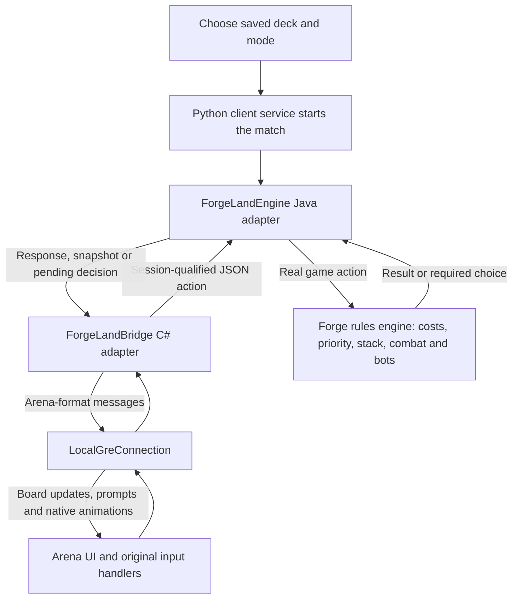

# How Arena and Forge work together

Forge owns the game's rules. The original Arena client supplies presentation and
input workflows. Our authored adapters translate between them.

Local requests/responses use the private `forge-ipc` folder. The bridge maps card
and ability identities and waits for matching results. A snapshot alone cannot
resume a dead rules process. Native animations retain their normal clock.

For private internet Commander, one host runs the authoritative Forge process.
An external authenticated HTTPS room worker carries commands and per-player
views; each client presents its permitted hand/board view and acknowledges
presentation. The host remains trusted with complete decks and game information.
The game executable itself retains zero network capabilities.

The sandbox does not use official Arena account services or matchmaking.
See [multiplayer](MULTIPLAYER.md) and [developer notes](DEVELOPMENT.md).
