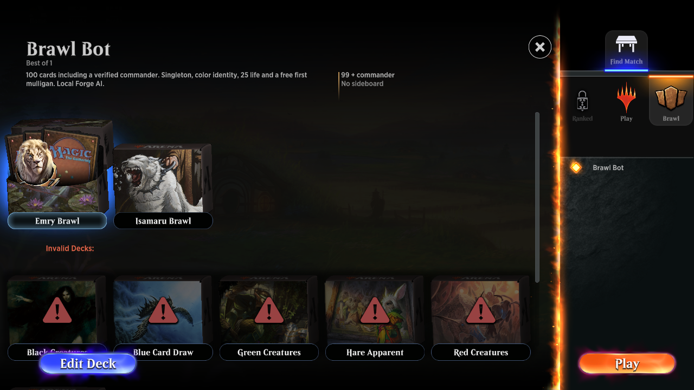
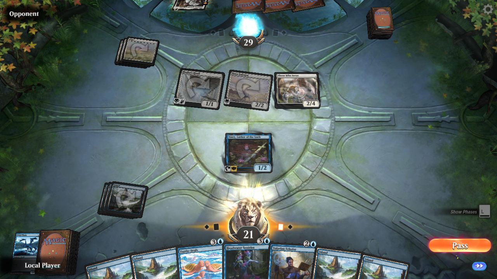
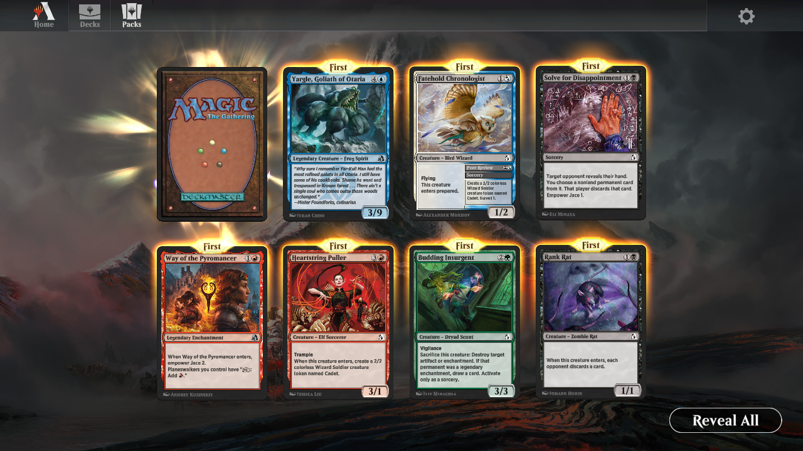

# In the client

These are actual local sandbox captures, not mockups. Original Arena artwork
and controls are loaded from the compatible game installation on that PC.
Screenshots are documentation; reusable game assets are not in the download.

## Home

Home stays available between games, with Decks, Packs, Options and Play. Online
advertisements, store/account controls and rewards are omitted.

## Brawl bot selection

The original Play panel offers a local Brawl Bot queue. Practice decks remain
visible as invalid for Brawl; verified 100-card commander decks can start.

## Emry on the battlefield

Emry was cast from the command zone using native card controls. Forge resolved
the entry trigger and milled four cards. The bot is local Forge AI.

## Pack opening

The original carousel and reveal controls use local pack balances and receipts.
The distribution is custom sandbox collation. Opening a card does not enable
unverified rules, and there are no retail wildcard rewards.

See [verification and remaining limits](VERIFICATION.md) before testing.
